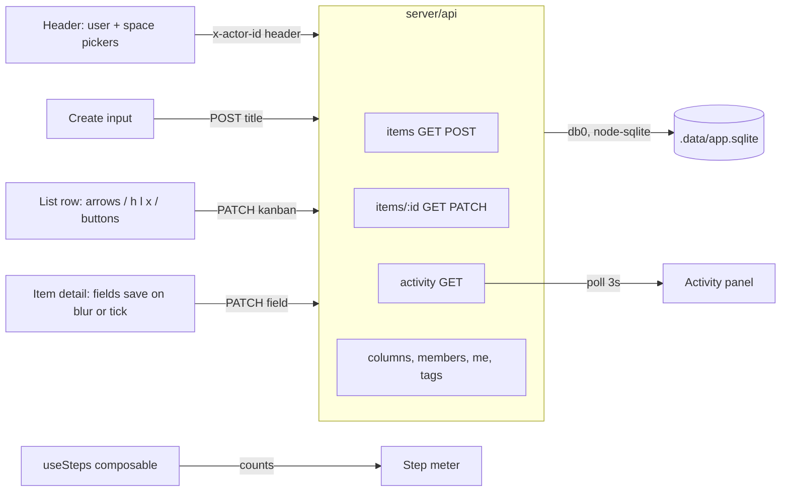

# Design

This run answers one question: how few steps does the ordinary life of a task
take, from a title to done? One screen holds everything: an input that creates
an item from a title alone, a list whose rows move by key or click, an
in-place detail editor, an activity panel of the other members' events, and a
counter of the steps each journey took.

Nuxt features in use: `server/api/` file routing, `server/utils/` auto-imports,
`useFetch` with reactive options, `$fetch`, `ref`/`computed`/`watch`,
components auto-imported from `app/components/`, a composable in
`app/composables/`, and one hand-written stylesheet.
