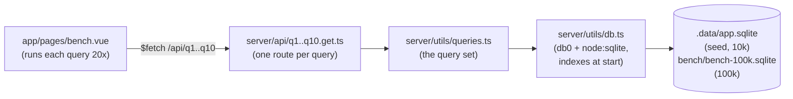

# Design

run-02 answers brief `fast-02-storage-sql`: what the Lerch data model looks
like as tables, and what it costs to read the views we need from 10,000
items. It is a bench, not a product screen. One page runs the brief's ten
queries against the seeded SQLite file and shows the times.

- Nuxt server routes under `server/api/` are the whole backend; a file there
  becomes a URL.
- The ten queries live in one module so the routes stay thin and the SQL is
  readable in one place.
- db0 is the database layer Nitro ships; the `node-sqlite` connector wraps
  `node:sqlite`, which Node 22 includes. Nothing needs compiling.
- `LERCH_DB` points the same code at the 100k file.
