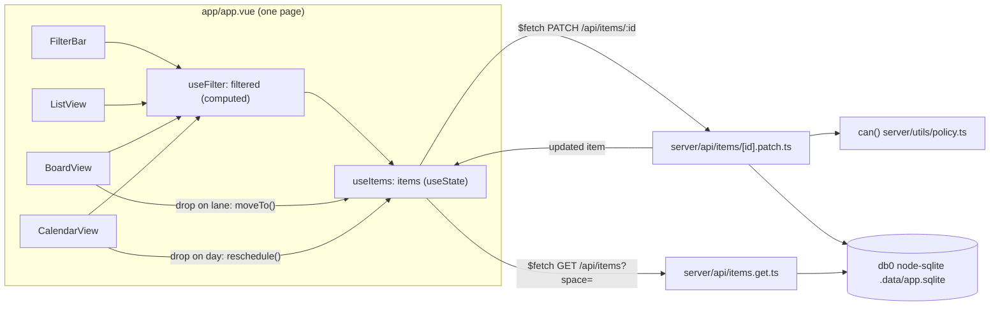

# Design

run-04 answers fast-04: does one item read well as a list row, a board card, and a calendar entry, and does a change in one view show in all of them? The page shows the three views side by side, or as tabs. They all read one client-side store. A drag on the board or the calendar sends a `PATCH` to one server route. The route updates SQLite and returns the item, and the store swaps it in. Every view redraws from that one change.

Nuxt features in use: auto-imported composables and components, `useState`, `computed`, `useFetch`, `useCookie`, `$fetch`, file-based server routes (`server/api`), `server/utils` auto-imports, and Nitro's experimental database layer (db0).
