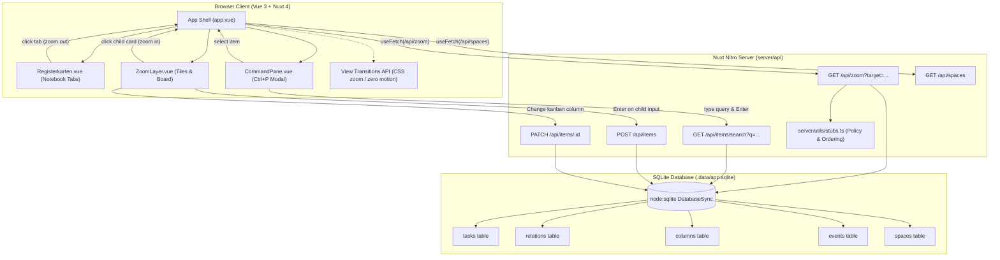

# Design: The Zoom Interface

`run-06` implements the "zoom interface" prototype for Lerch as outlined in `briefs/fast-06-zoom-interface.md`.

In this model, the entire workspace is structured around a single metaphor: **zoom into an item**. A space serves as the outermost container, holding root projects. Zooming into any project opens a layer displaying its child epics, zooming into an epic opens its stories, and zooming into a story opens its tasks. Every zoom layer presents a consistent toolset: the item's own attributes, notebook index tabs (*Registerkarten*) depicting the zoom path, child tiles, a quick child-item creation bar, and a kanban board of children. A keyboard-driven command pane (`Ctrl+P`) allows immediate fuzzy jumping to any item at any depth.

## System Architecture and Action Flow

## Nuxt & Web Platform Features in Use

1. **Nuxt 4 / Nitro File Routing:** `server/api/zoom.get.ts`, `server/api/spaces.get.ts`, `server/api/items/search.get.ts`, `server/api/items/index.post.ts`, and `server/api/items/[id].patch.ts`.
2. **Built-in `node:sqlite`:** Synchronous database operations with prepared statements via `DatabaseSync` on Node 22 without native compilation dependencies.
3. **View Transitions API:** Smooth state-to-state page morphing wrapped in `document.startViewTransition()` during zoom operations.
4. **Accessible Reduced-Motion Controls:** Respects `prefers-reduced-motion: reduce` by default and enforces a strict `.no-animations` rule ("With animations off, nothing moves").
