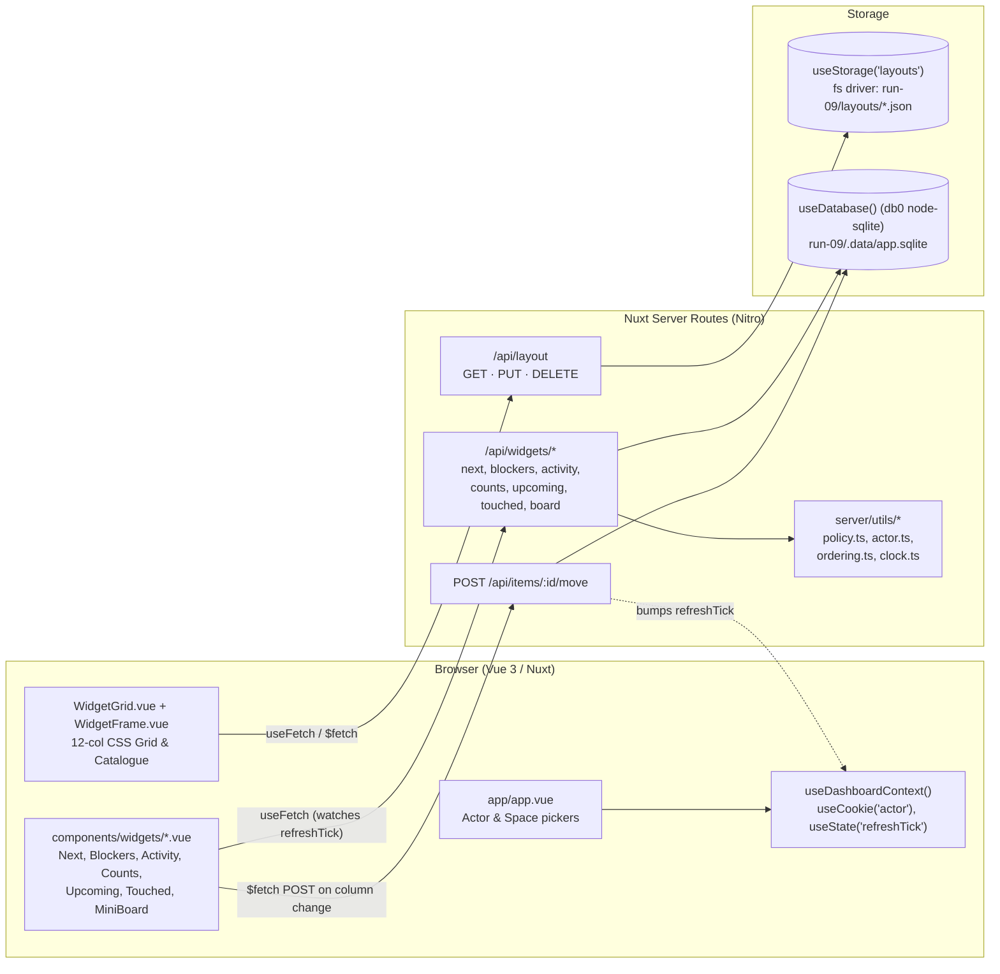

# Design — fast-09: widgets on a grid

`run-09` explores a space's morning screen built from widgets a member takes up, moves, resizes, configures, or removes on a 12-column grid. Each space has a default layout (`layouts/space-<space>.json`), and the first time a member changes the grid, the server writes that member's personal copy (`layouts/user-<space>-<actor>.json`) so other members still see the space's default.

## Nuxt features in use

- **File-based server routes (`server/api/`):** each `.get.ts`, `.put.ts`, `.post.ts`, and `.delete.ts` file becomes an HTTP endpoint without a router table.
- **Auto-imported server utilities (`server/utils/`):** `can()`, `currentActor()`, `NEXT_ORDER_BY`, `shifted()`, and `builtInDefaultLayout()` are available in every route handler automatically.
- **Nitro `useDatabase()` (db0 + `node:sqlite`) and `useStorage('layouts')` (unstorage `fs`):** SQL queries read the seeded `.data/app.sqlite` database; layout configurations are stored as JSON files in `run-09/layouts/`.
- **SSR + client reactivity (`useFetch`, `useCookie`, `useState`):** the initial page renders on the server with the acting person's layout and live widget data, then updates in place when the person switches actor, reconfigures a widget, or moves an item on the board.
